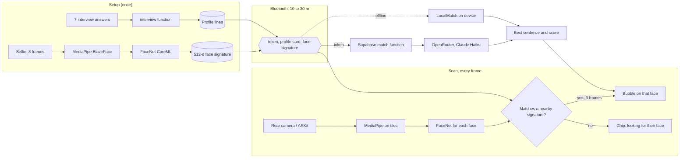
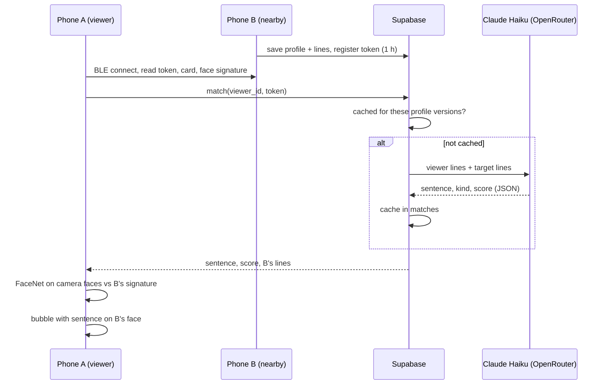

# Bubbles

Hold up your iPhone at an event and every nearby Bubbles user gets a manga speech bubble over their head with **one sentence**: the line from their profile that matters most to you. If you need help with ML and they teach PyTorch, their bubble says so.

## Features

- **Live scan:** rear camera; bubbles stay on people's faces as they walk around.
- **Face recognition from your own photo:** each user takes a photo at setup. It becomes a face signature on the phone, and only that signature is shared, over Bluetooth. No photo is stored or sent.
- **Best line for you:** Claude Haiku (via OpenRouter, from a Supabase Edge Function) picks the target's most useful line for the viewer and scores the match from 0 to 100.
- **Works offline:** profiles also travel over Bluetooth, so two phones match on device without a backend.
- **Onboarding:**
  - photo, then 7 spoken questions (branch, interests, hobbies, today, project, what you can help with, what you need)
  - Claude turns the answers into profile lines
  - optional plan lines from your calendar
- **Edit profile:** tap your name chip to edit lines, retake the photo or redo the interview.
- **Wave and Catch** people from their card. The Caught grid shows rarity by match score.
- **Demo mode:** a bundled clip with demo people, the stage fallback. It's the default in the simulator.

## How it works





## Quick start

Requirements: macOS with Xcode (iOS 26 SDK), [xcodegen](https://github.com/yonaskolb/XcodeGen), [uv](https://github.com/astral-sh/uv), and an iPhone running iOS 26 (iPhone 11 or newer).

```sh
git clone https://github.com/dhyanagni2001-commits/bubbles.git && cd bubbles

# Large model files (gitignored)
ios/scripts/fetch_mediapipe.sh      # MediaPipe frameworks + face detector (~1.2 GB)
ios/scripts/make_facenet.sh         # FaceNet → CoreML (~45 MB)

cd ios && xcodegen generate && cd ..

# Build and install on connected iPhones (free Apple account works; installs last 7 days)
ios/scripts/sideload.py --list
ios/scripts/sideload.py --all
```

On a new iPhone, first turn on **Developer Mode** (Settings → Privacy & Security). After installing, trust the developer under Settings → General → VPN & Device Management.

### Backend (optional)

```sh
supabase link --project-ref <your-ref>
supabase db push --remote
echo "OPENROUTER_API_KEY=sk-or-..." > supabase/.env      # gitignored
supabase secrets set --env-file supabase/.env --yes
supabase functions deploy --use-api --yes
```

Put your project URL and publishable key in `Config` in `ios/Bubbles/Models.swift`. Leave the URL empty to run fully offline: Bluetooth cards plus on-device matching.

## Repo layout

| Path | What |
| --- | --- |
| `ios/` | SwiftUI app (`project.yml` for xcodegen, `Bubbles/` sources, `scripts/`) |
| `supabase/` | Postgres schema and Edge Functions: `match`, `interview`, `calendar_lines` |
| `mockup/` | Browser emulator used as the visual reference |
| `docs/PLAN.md` | Product decisions and architecture |
| `docs/DESIGN.md` | Manga visual spec |
| `CONTEXT.md` | Full project context on one page (start here) |

## Privacy notes

- Faces are matched only against people whose phones are nearby and who took a photo in Bubbles.
- The app keeps signatures, never images.
- Hackathon build: Bluetooth data is not encrypted, and the database access rules are open. Tighten both before any public release.
