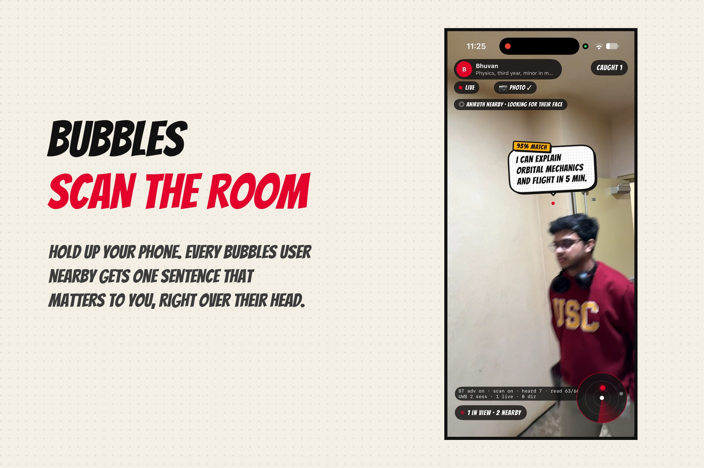
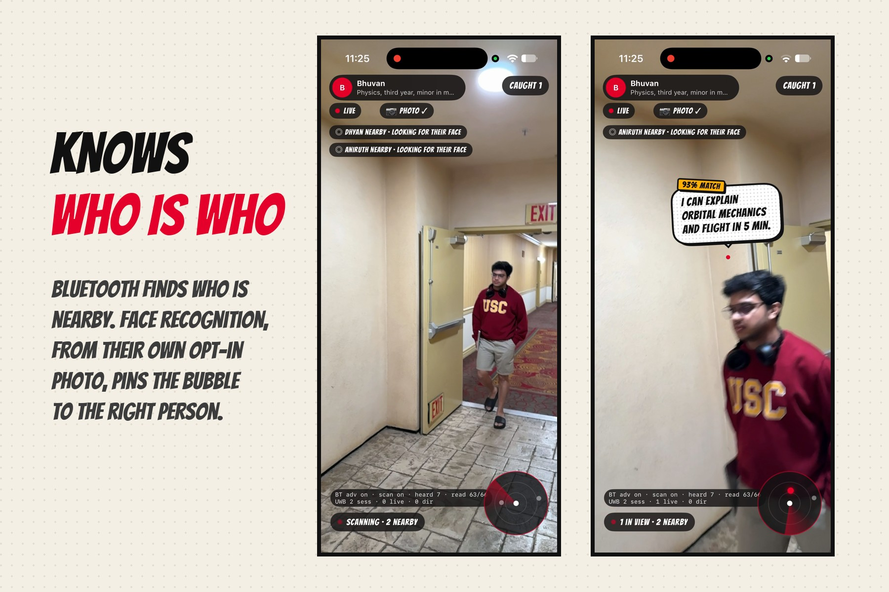
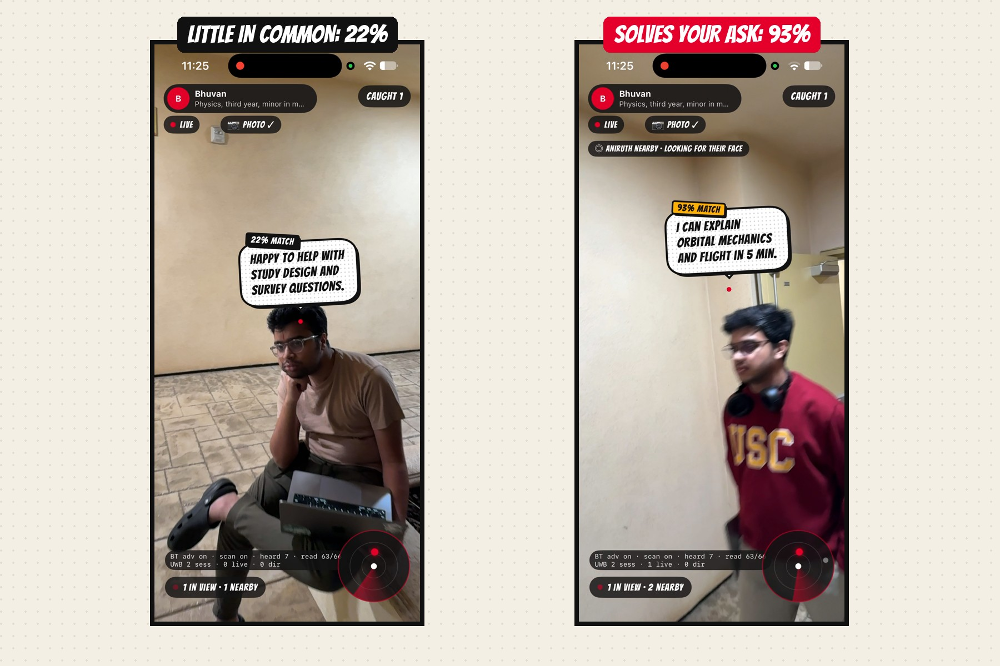
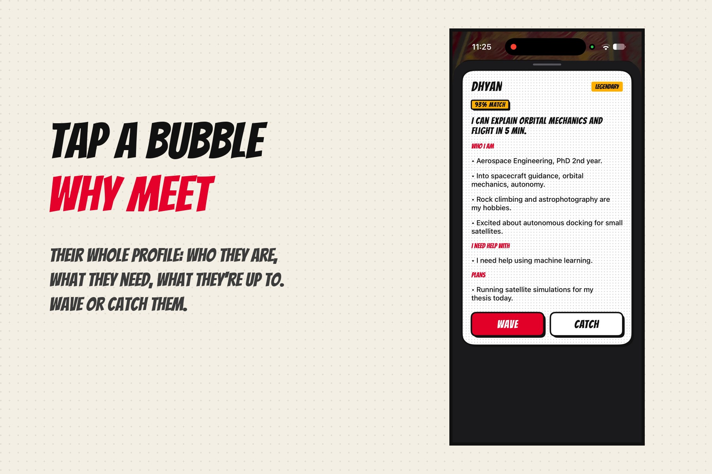
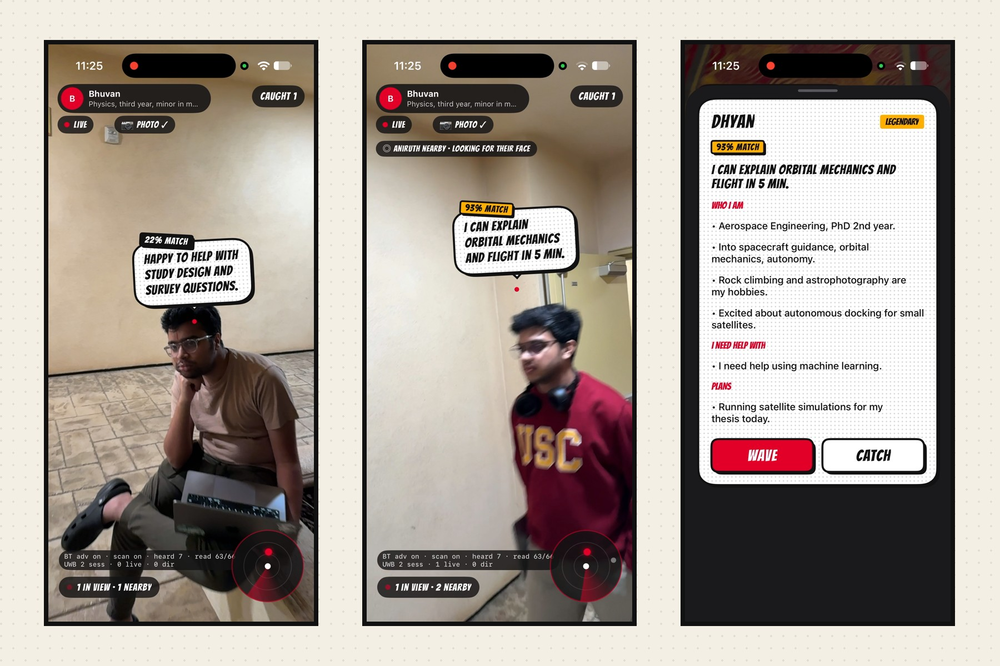

# Bubbles: a reason to say hello

Demo video: https://youtu.be/QcLPG1QAdx0

## Inspiration

Thousands of students cross campus every day, passing people who might share their interests, solve a problem they’re stuck on, or become their next project teammate. Usually, neither person knows.

We wanted to use AI to make those connections visible.

What if an aerospace student struggling with orbital prediction could immediately discover that the person walking past them builds machine learning models for physics?

That became **Bubbles: a reason to say hello.**

## What it does

Bubbles brings the discovery and collection of **Pokémon GO** to campus connections, with **manga-style speech bubbles** above nearby students in your camera view.

Students start by answering a short questionnaire about their academic interests, hobbies, projects, skills, and the help they need. They can speak or type their answers, then review and approve the profile lines.

When nearby Bubbles users appear, AI selects **one sentence from their profile that matters most to the viewer**.

The same person might appear to an aerospace student as someone who builds orbital prediction models, and to another student as someone looking for a basketball game.

**You have one profile. But the part of you that matters is different to everyone.**

Students can tap a bubble to explore someone’s profile, send a Wave, or **Catch** them by saving their profile card in a **Caught collection**. Each saved card keeps the conversation starter and match rarity, giving you a personal collection of people you want to reconnect with. Discover someone interesting now; remember why you connected later.

## How we built it

We built a native iPhone app using **Swift and SwiftUI**, with **ARKit** providing the camera experience and **MediaPipe** detecting faces.

**CoreBluetooth** discovers nearby users and exchanges compact profile cards. We also tested **Ultra-Wideband positioning** to associate nearby users with positions in the camera view. Face detection finds the faces; UWB supplies the positioning information for deciding where their bubbles belong.

Our backend uses **Supabase**, including Postgres and Edge Functions. **Claude, accessed through OpenRouter**, turns interview answers into concise profile lines and compares profiles to select a relevant conversation starter.

Matching prioritizes useful connections: someone’s offer answering your question, a project you could contribute to, or a shared interest. Results are cached so the app can prepare a sentence before someone enters view.

Bluetooth profile sharing and local matching provide a fallback when internet access is unavailable.

## Challenges we ran into

The hardest challenge was connecting a nearby phone to the correct person in a moving camera view. Discovering a device and placing a bubble accurately are separate problems. UWB showed promise, but reliable placement while people move remains an area for improvement.

We also had to manage Bluetooth discovery, connection retries, changing device identifiers, and network failures.

On the design side, the challenge was restraint. Someone walking past gives you only a few seconds to read. We kept every bubble to one sentence and built collision handling to keep nearby bubbles readable.

## Accomplishments we’re proud of

We built an app that makes meeting people feel exciting. Manga bubbles, bold typography, animated match badges, and a Pokémon GO-inspired Catch collection give campus discovery a playful visual identity.

We brought onboarding, profile editing, nearby discovery, AI matching, the camera interface, and Wave/Catch interactions together in a native iPhone app.

We’re also proud of prototyping a lightweight approach to identifying nearby users without visual identity recognition: Bluetooth discovers their devices, and UWB provides positioning information. Computer vision only needs to detect where faces are, while the radio technologies handle identity association in the positioning prototype.

We’re especially proud of making personalization immediately understandable: AI chooses a specific detail that gives two students something to talk about.

## What we learned

**Necessity is the mother of innovation.** When someone walks past, we have a golden window of roughly five seconds to give them a reason to connect. Spending that window on a costly face-recognition pipeline would work against the experience we wanted to create.

That pushed us to explore letting existing technology do the heavy lifting: Bluetooth for nearby discovery, UWB for positioning, and face detection for locating faces in the stream. Our lesson was to use the simplest tool for each job and keep AI focused on the meaningful question: **what should these two people know about each other?**

Useful matching also goes beyond shared keywords. An aerospace student and a machine learning student may describe themselves differently while being exactly who the other needs.

We also learned that responsiveness, readable design, and graceful fallbacks are essential to making a complex technical system feel simple.

## What’s next

We want to improve positioning reliability and test Bubbles with students moving through real campus spaces.

Next, we plan to introduce a spoken daily check-in: **“What are you up to?”** This would keep profiles relevant as students move between classes, projects, clubs, and games.

We also want to explore **Meta glasses and future AR wearables**. Imagine walking across campus and seeing a relevant conversation starter in your view without holding up a phone. The phone is our starting point; a hands-free campus discovery experience is the direction we want to explore.

Our goal is simple: help students recognize the possibilities already walking past them.

## Gallery

| | |
| --- | --- |
|  |  |
|  |  |

